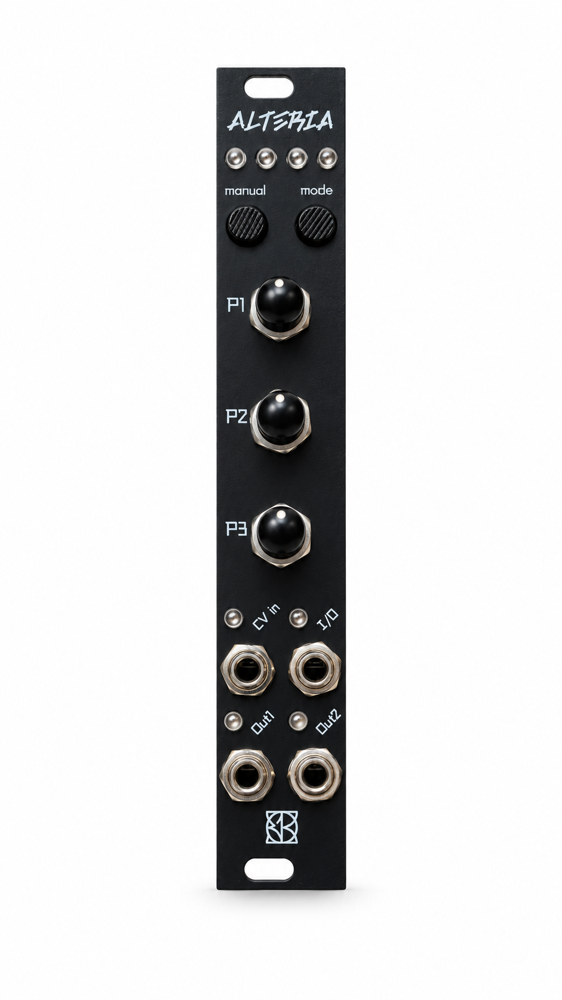
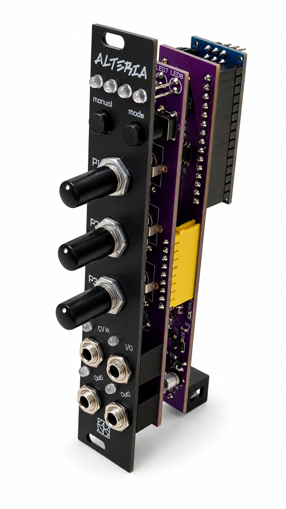
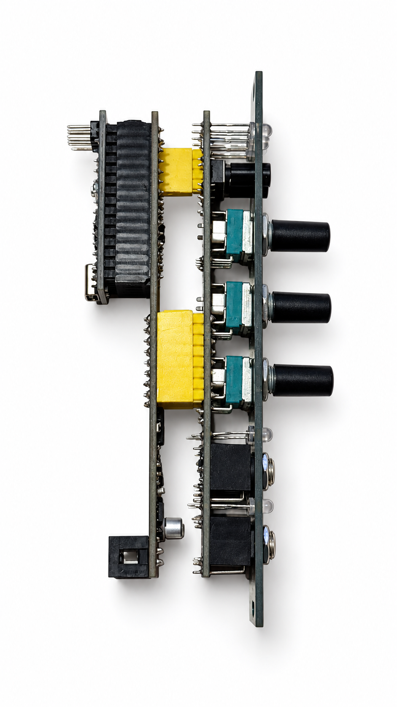
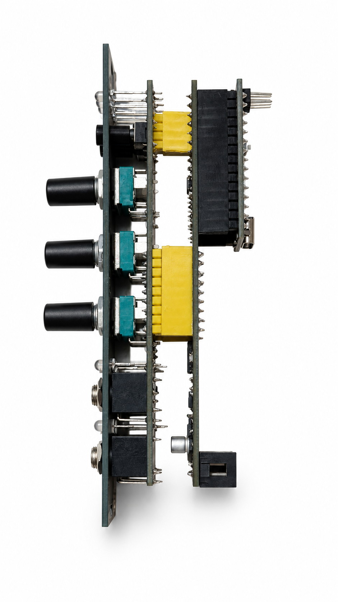
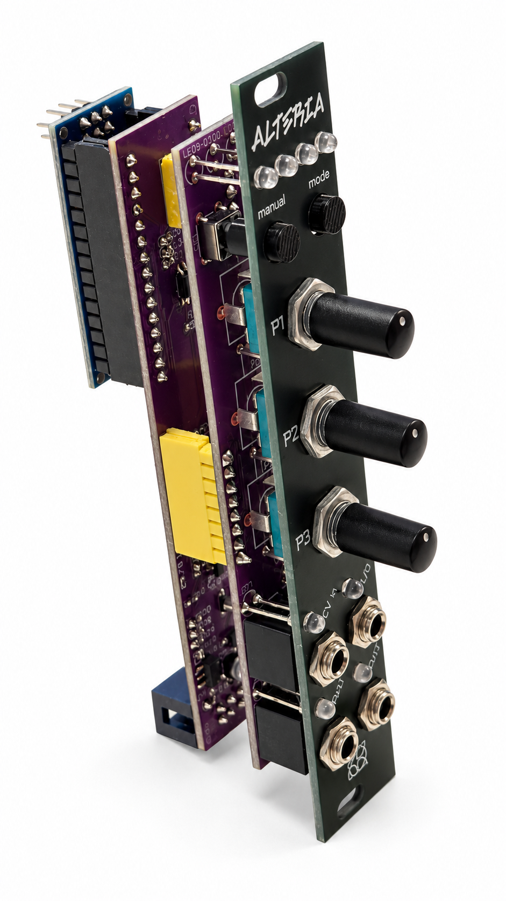

# ALTERIA

### One module. Sixteen ways to move a patch.

**Open-source firmware for a compact Eurorack function generator, rhythm utility and lo-fi percussion instrument.** Three knobs, two buttons and two calibrated DAC outputs, with separate **DRUM LAB** and experimental **FULL VOICE** firmware.

 

More product views

  

Product photographs retouched with AI for background and lighting. [Photo notes](PHOTO_EDIT_NOTES.md).

[Allrounder manual](firmware/ALTERIA_ALLROUNDER/README.md) · [Calibration](docs/CALIBRATION.md) · [DRUM LAB](firmware/ALTERIA_DRUM_LAB/README.md) · [Build and modify](docs/DEVELOPMENT.md) · [Schematics](hardware/schematics/README.md)

**Quick reference:** [ALLROUNDER](docs/quick-reference/ALLROUNDER.md) · [DRUMLAB](docs/quick-reference/DRUMLAB.md) · [FULLVOICE - UNTESTED](docs/quick-reference/FULLVOICE.md).

## Choose your firmware

| Firmware | Version | Purpose | Hardware |
| --- | --- | --- | --- |
| **ALLROUNDER** | **2.0.2**, 27 October 2026 | Sixteen modes covering envelopes, rhythm, modulation, pitch CV and two drum voices | REV5-2, Nano ATmega328P, 16 MHz |
| **DRUM LAB** | **1.0.0**, 27 October 2026 | Two independent percussion voices, each with eight selectable engines and three effects | Same hardware |
| **FULL VOICE** | **1.0.0**, 31 October 2026, **UNTESTED ON HARDWARE** | Mono oscillator/filter/VCA voice, four editing pages, AD envelope, nominal V/oct + trigger input | Same hardware |

These are separate sketches; upload one at a time. They do not require an external audio library. SPI and EEPROM come with the Arduino AVR core. **ATmega168P is not a supported replacement for these releases.**

Download this repository with **Code → Download ZIP**, extract it, and open the matching `.ino` inside its own folder under `firmware/`. In Arduino IDE select **Arduino Nano → ATmega328P**; choose Old Bootloader only if required by your Nano. The [development guide](docs/DEVELOPMENT.md) includes reproducible CLI builds and tests.

## ALLROUNDER 2.0.2

One mode runs at a time. Short MODE presses advance 1–16. LEDs 1–4 have binary weights 1, 2, 4, 8; mode 16 uses preset indicators instead.

| # | Mode | In a patch |
| --- | --- | --- |
| 1 | AD Shaper | Attack/decay envelope and event markers |
| 2 | AR Gate | Gate-held envelope with release |
| 3 | Dual Decay | Two independently triggered vactrol-style decays |
| 4 | Ducking | Smoothed response to control voltage |
| 5 | Burst | Trigger clusters with complementary ramps |
| 6 | Acid Generator | Clocked 16-step Phrygian pitch pattern, accents and slides |
| 7 | Tremolo / AutoPan | Complementary positive modulation CVs |
| 8 | Grids XY | Pattern-based kick/snare/hat triggers |
| 9 | Triple Clock | Three independent ratios from /8 to ×8, tap or external clock |
| 10 | Mutant Drums | Internal kick/snare audio synthesis |
| 11 | Logic XOR | Two clocks and XOR result |
| 12 | Turing Machine | Mutating register, CV and bit output |
| 13 | Humanizer | Event delays, swing and gate variation |
| 14 | Bernoulli 3 | Probabilistic event routing |
| 15 | Trance Gate | Twenty-four rhythmic patterns |
| 16 | Preset Manager | Four stored CV pairs and gates |

[The full control table](firmware/ALTERIA_ALLROUNDER/README.md) covers P1/P2/P3, CV IN, MANUAL, OUT1, OUT2 and I/O for every mode. Acid pitch needs an external oscillator/audio path; Tremolo/AutoPan supplies CV to external VCAs. Mutant Drums creates audio inside ALTERIA. Triple Clock needs **at least three taps** to set tempo and continues at its last tempo when an external clock stops.

### Know the outputs

| Mode | OUT1 / OUT2 target | I/O jack |
| --- | --- | --- |
| 1–9 and 11–15 | 0…+5 V CV/gate | Digital output, except mode 3: trigger input B |
| 10 | Approximately ±2.5 V audio | Snare trigger input |
| 16 | −5…+5 V CV | Stored digital gate output |

**Disconnect external drivers from I/O before leaving mode 3 or 10 or restarting:** other modes drive that jack as an output. These are firmware targets, not a certified electrical input range. Connect audio to an attenuated mixer/VCA input, not directly to headphones or speakers.

### Calibration

Calibration is manual, with a multimeter at the output jacks. Hold **MODE + MANUAL at power-on/reset**, release at LED1, then adjust both outputs at **0 V, +5 V and −5 V** using P1/P2. Center both knobs before each MANUAL confirmation. At blinking LED4, hold MANUAL **1 second** to save. MODE held **1.2 seconds** cancels. Read the [complete calibration guide](docs/CALIBRATION.md) before starting.

The six points are stored per board in two CRC-protected EEPROM records. This adjusts output offset and positive/negative scale; it does not calibrate inputs or guarantee perfect 1 V/oct tracking.

## DRUM LAB 1.0.0

Two independent audio outputs. Assign **Kick, Tom, Synth Perc, Snare, Clap, FM Metal, Closed Hat or Open Hat** to either voice. SOUND controls pitch/duration/character; FX adds tone, drive and crush. Hat pairs support choke. This is original AVR synthesis inspired by broad percussion families, not an LXR firmware port or an official Erica Synths product.

- **CV IN → voice A → OUT1; I/O → voice B → OUT2.** I/O stays an input throughout DRUM LAB.
- MODE short: next engine on the selected voice. MODE held about 650 ms: select A/B.
- Hold MODE, add MANUAL within half a second, release both: switch SOUND/FX.
- MANUAL short: trigger the selected voice. MANUAL held 2 seconds: save the kit after the initial hit.
- Knobs use pickup after recall. Eight engines are available to each voice, with **two voices sounding simultaneously**, not eight.

Audio runs at **6.4 kHz** with deliberate lo-fi character. There is no internal sequencer: use external triggers or MANUAL. [Read the complete DRUM LAB manual](firmware/ALTERIA_DRUM_LAB/README.md), including EEPROM, LED meanings, calibration and [attribution](firmware/ALTERIA_DRUM_LAB/ATTRIBUTION.md).

## FULL VOICE 1.0.0 - UNTESTED ON HARDWARE

**NON TESTATO SU HARDWARE / UNTESTED ON HARDWARE.** This experimental sketch
has passed compilation, host tests and AVR binary simulation, but has not been
validated on a physical module. It is not a stable/hardware-approved release.

CV IN is nominal 1 V/oct pitch; I/O stays an input for gate/trigger; OUT1 is
filtered/VCA audio, OUT2 is a positive AD envelope. Four pages: OSC (waveform,
PWM, fine tune), FILTER (cutoff, resonance, AD amount), VCA (level, AD amount,
drive), ENV (**Attack, Decay, curve; no sustain/release**). MODE short goes
forward, MANUAL short back; MANUAL held 500 ms auditions a note, MODE held
1.2 seconds saves the patch. Knobs use pickup.

[Quick reference](docs/quick-reference/FULLVOICE.md) ·
[Complete manual and sketch](firmware/ALTERIA_FULL_VOICE) ·
[Untested status](firmware/ALTERIA_FULL_VOICE/STATUS.md).
Lo-fi 6.4 kHz, approximately +/-2.5 V audio and 0..+5 V envelope targets.
Physical levels, sound and V/oct tracking still require bench tests; output
ACAL does not calibrate the pitch ADC. Recorded build: **14536 bytes flash,
513 bytes static SRAM**. Allrounder and DRUM LAB sources remain unchanged.

## Open-source status and verification

Complete editable firmware and software tests are included. The **updated two-page schematic PDF supplied on 28 October 2026** is available in [hardware/schematics](hardware/schematics/README.md). Native CAD and a matching manufacturing package remain to be added.

Allrounder 2.0.2: recorded AVR build **29,448 / 30,720 bytes flash**, **1,094 / 2,048 bytes static SRAM**. DRUM LAB 1.0.0: **18,458 bytes flash**, **966 bytes static SRAM**. Stack and runtime headroom need separate consideration. Existing [Allrounder](firmware/ALTERIA_ALLROUNDER/TEST_REPORT.md) and [DRUM LAB](firmware/ALTERIA_DRUM_LAB/TEST_REPORT.md) reports distinguish host/AVR simulation from measurements on the real board. The prior Allrounder 2.0.1 audio path has a positive user report; the 2.0.2 timbre update and DRUM LAB still need listening and bench verification.

Original materials: **GNU GPL-3.0**. [License](LICENSE) · [Notice](NOTICE.md) · [Contribute](CONTRIBUTING.md). Related projects: [faun](https://github.com/E103-designs/faun) · [SINCRIA](https://github.com/E103-designs/SINCRIA).
