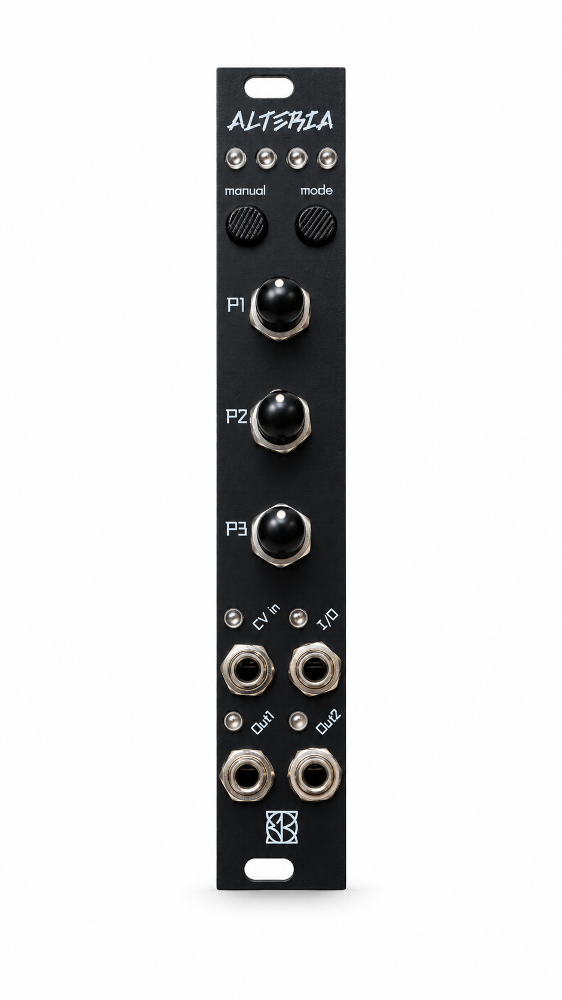
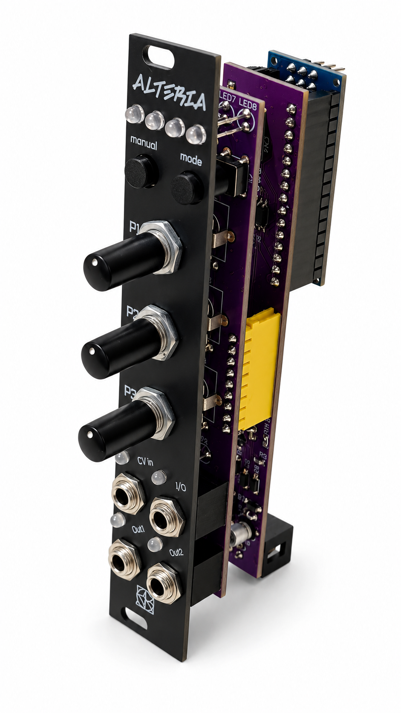

# ALTERIA

Firmware open source per un modulo Eurorack da 4 HP: inviluppi, ritmo, modulazione, sintesi e preset CV. ALTERIA REV5-2 ha tre potenziometri, due pulsanti, quattro LED di modalità, CV IN, un jack digitale I/O e due uscite su DAC MCP4822.

## Scegli il firmware

| Firmware | Versione | Funzione |
| --- | --- | --- |
| [ALLROUNDER](ALLROUNDER/) | 2.3.0 | 16 modalità CV e ritmo, con Euclidean Trigs e S&H Glide |
| [DRUM LAB](DRUM-LAB/) | 1.0.0 | Due voci percussive, otto motori e pagine SOUND/FX |
| [FULL VOICE](FULL-VOICE/) | 1.0.0 | Sintesi monofonica con oscillatore, filtro, VCA e inviluppo |
| [MACRO VOICE](MACRO-VOICE/) | 1.0.0 | Cinque modelli di oscillatore, dal wavefold al Karplus |
| [ACPM](ACPM/) | 1.0.0 | Preset CV e gate, fino a 16 step via clock o indirizzo CV |

Vuoi un solo modo? La [libreria Additional Modes](Additional-Modes/) offre **47 sketch standalone** e i relativi snippet. Vuoi creare la tua combinazione? Nel [Firmware Builder](Firmware-Builder/) puoi scegliere e ordinare fino a 16 modalità, consultare il codice ed esportare sketch, guida e HEX dopo una compilazione valida.

## Compila e carica

Scarica il repository e apri lo sketch dalla sua cartella `Firmware/` o `Standalone/`. In Arduino IDE installa **Arduino AVR Boards 1.8.6** e seleziona **Arduino Nano / ATmega328P, 16 MHz**; usa **Old Bootloader** solo se richiesto dalla scheda. SPI ed EEPROM sono già nel core. Il target di questi cinque firmware è **REV5-2**; le revisioni storiche e ATmega168P hanno mapping o limiti diversi.

Scollega i segnali in ingresso dal jack **I/O** prima di cambiare firmware: la direzione dipende dal modo. Su REV5-2, I/O digitale usa D2; OUT1 e OUT2 sono i canali A/B del DAC e D12 pilota LDAC. Le tensioni descritte nei manuali sono nominali. La [taratura](docs/CALIBRATION.md) regola separatamente i due DAC.

[Schema](hardware/schematics/) · [Sviluppo e test](docs/DEVELOPMENT.md) · [Changelog](CHANGELOG.md) · [Licenza GPL-3.0](LICENSE) · [Attribuzioni](NOTICE.md)
